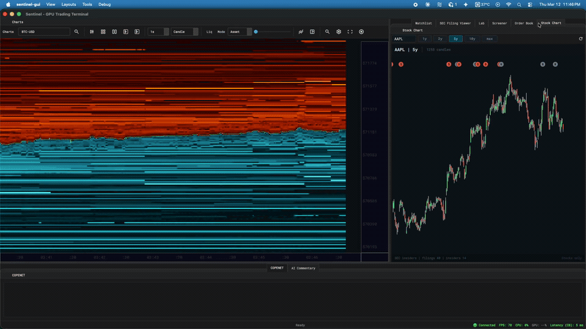
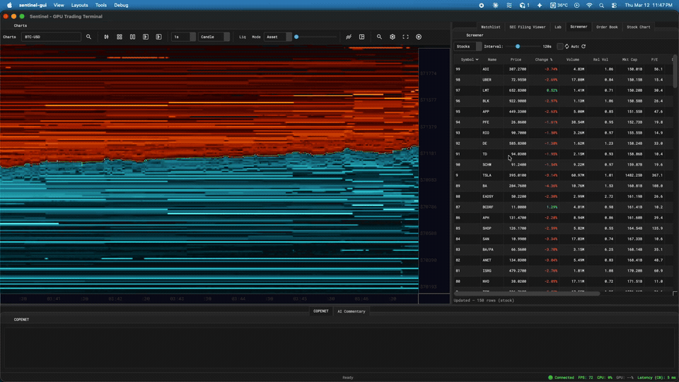

# Sentinel

**A GPU-rendered order-flow terminal for Coinbase spot markets**, written in C++20 and Qt 6.


Sentinel records the full level 2 order book and trade tape of the products you choose, keeps that
recording as a gap-aware history, and draws it live as an order book heatmap with candles and
volume overlays. Orders are simulated. Sentinel has paper trading only and sends no real orders.

Status: alpha (`3.0.0-alpha`). It runs around the clock on the maintainer's Mac and records
seven products. Documentation index: [docs/README.md](docs/README.md).

<div align="center">
  
  
  
  
  
</div>

---

## Screenshots

The image at the top is from 2026-10-27: hours of recorded BTC-USD heatmap history with candles,
and the Order Book dock in cumulative (Σ) mode with Pulse, Lean and grouped rows. The two below were
captured with a March 2026 build, and their controls have changed since.

| Stock Chart with SEC insider signals | Screener |
| --- | --- |
|  |  |

---

## What it does

### Recording

- **`sentinel-capture`** opens one Coinbase Advanced Trade WebSocket per product and writes every
  frame (level 2, trades, heartbeats) to a compressed, checksummed journal (RAWL2). It needs no API
  key. A local socket streams the same records to the server as they arrive.
- **The server rolls the journal into a heatmap history** (HMC2): one-minute columns for each
  product, with hourly rollups. A missing or invalid stretch is stored as a gap, not as guessed data.
- **Hourly self-check.** The server re-rolls each completed hour from the same journal and compares
  it with what it recorded live. Mismatches are counted and raise an alert.
- **Book recovery.** If the recorder has to mark a book invalid, the server asks capture for a fresh
  snapshot. It asks only once the connection has been stable for a grace period and is still
  delivering records, and it backs off between requests, so it does not break a new connection
  that is about to send its own snapshot.
- **Restart rebuild.** At startup the server rebuilds the last 30 minutes of 100 ms and 1 s candles
  from the journal, so short timeframes have history right after a restart.
- **Metrics** for Prometheus on `127.0.0.1:8090` (server) and `:8091` (capture), with Grafana
  dashboards and alert rules in [ops/monitoring](ops/monitoring/README.md).

### Charting (GPU)

- **Order book heatmap**: recorded history plus a live edge, binned on the GPU at the chart's tick
  size (Auto or Manual). A test checks that GPU cells equal the CPU reference exactly.
- **Candles**: Candle, Hollow and Line styles. Timeframes 100 ms, 1 s, 1 m, 5 m, 15 m, 1 h, 4 h and
  1 d. 100 ms and 1 s bars are built by the server from the journal (30 minutes of 100 ms history
  in memory). 1 m and longer load from Coinbase in pages of 350 bars as you pan back; the server
  caches them.
- **Overlays**: trade bubbles, Footprint, TPO and Volume Profile, switched from the chart toolbar.
- **Text** is drawn from an MSDF glyph atlas on the GPU; there is no per-cell QML.
- Backends: Metal on macOS; Direct3D 12 or Vulkan on Windows (Direct3D 11 is refused, see
  [docs/WINDOWS_GPU_TESTS.md](docs/WINDOWS_GPU_TESTS.md)).

### Market tools

- Order book (DOM) ladder dock.
- Stock Chart dock (daily equity candles) with SEC Form 4 insider overlays from EDGAR.
- TradingView screener dock for crypto and stocks; watchlists. Crypto rows open on the main chart,
  stocks on the Stock Chart.

### Paper trading and backtests

- Server-side paper trading: market and limit orders, positions, PnL, and TP/SL brackets that the
  server holds and triggers. Hotkeys `B` (buy), `S` (sell), `F` (flatten) and `C` (cancel all).
- `sentinel-backtest` replays journal trades or a CSV file through the same simulation core. The
  Paper Trading dock has a Backtest tab and runs the AvendellaMM market-making algo in paper mode.
- Walkthrough: [docs/PAPER_TRADING_QUICKSTART.md](docs/PAPER_TRADING_QUICKSTART.md).

### Automation

- The GUI serves a local Agent API (HTTP on `127.0.0.1:17100`) to read chart, book, trade and
  heatmap state and to drive the chart. See [docs/AGENT_API.md](docs/AGENT_API.md). It has no
  authentication: keep it on loopback.

## Performance

Measured on the maintainer's always-on setup unless a row says otherwise: Mac mini M4 (10 cores,
16 GB), macOS 26, services built from `main`, recording seven products (BTC, ETH, SOL, FARTCOIN,
PEPE, DOGE and AVAX against USD), journal on an external USB SSD. Production rows come from
Prometheus metrics scraped every 15 s over the 7 days to 2026-10-21. CPU is a share of one core.
Every number, with its query or command and its date, is in
[docs/README_CLAIMS.md](docs/README_CLAIMS.md).

| What | Result |
| --- | --- |
| Capture process (7 WebSockets, journal writer) | CPU median 3.7 %, p95 5.2 %; resident memory median 27 MB |
| Server process (roller, recorder, self-check, stream) | CPU median 5.2 %, p95 9.1 % (see the open issue above) |
| Journal volume, all 7 products | about 82 frames/s; 0.98 GB/day on disk |
| Live feed availability at the server | 99.96-99.98 % of scrapes per product, restarts and deploys included |
| Server main-thread queue wait | per-minute p99: median 0.08 ms; worst single wait 53 ms; none over 100 ms |
| Hourly self-check | 0 mismatching buckets in about 168 hourly comparisons per product |
| Restart to serving (3 restarts, 19-21 Oct) | 2.6-6.7 s; 30 min of 100 ms and 1 s candles rebuilt for all 7 products, slowest product 1.1-4.8 s |
| Capture journal append to fan-out client receive (synthetic bench: 100 frames/s of 1.5 KB, one client, 3 runs of 65 s) | p50 93-99 µs, p95 150-157 µs, worst 1.0-2.4 ms |
| Test suite at the last landing | 116 CTest tests pass with a real GPU required (Metal) |

The client's frame rate and frame time are not in this table: there is no repeatable GUI benchmark
yet ([docs/TODO.md](docs/TODO.md)).

## Architecture

```
Coinbase WS ──> sentinel-capture ──> RAWL2 journal (disk) ─┐
                      └── local fan-out socket ────────────┤
                                                           v
                    sentinel-server: roller ─> HMC2 history, candles, book, trades
                                                           │  TLS WebSocket (127.0.0.1:8080)
                                                           v
                    sentinel-gui: stream client ─> chart core ─> Qt Scene Graph ─> GPU
```

| Path | Owns |
| --- | --- |
| `libs/core` | Capture, journal, roller, server model, protocol, paper trading. QtCore only. |
| `libs/gui` | Qt Quick, QML and scene graph rendering, docks and widgets. |
| `apps/` | Thin executables: `sentinel-capture`, `sentinel-server`, `sentinel-gui`, `sentinel-roll`, `sentinel-backtest`, `sentinel-lab`. |

Details: [docs/ARCHITECTURE.md](docs/ARCHITECTURE.md), [docs/RAW_CAPTURE.md](docs/RAW_CAPTURE.md),
[docs/ROLLER.md](docs/ROLLER.md), [docs/MARKETDATA.md](docs/MARKETDATA.md).

---

## Build from source

Dependencies come from vcpkg (`VCPKG_ROOT`) and an installed Qt 6; each preset reads the Qt path
from an environment variable.

**macOS** (primary platform):

```bash
brew install qt cmake ninja
export QT_MAC=/opt/homebrew/opt/qt
export VCPKG_ROOT=$HOME/vcpkg

git clone https://github.com/pattty847/Sentinel.git
cd Sentinel
cmake --preset mac-clang
cmake --build --preset mac-clang -j 6
```

**Windows** (Visual Studio 2022 C++ workload, CMake, vcpkg, Qt for MSVC):

```powershell
$env:QT_MSVC = "C:\Qt\6.9.3\msvc2022_64"   # your Qt directory
$env:VCPKG_ROOT = "C:\dev\vcpkg"
cmake --preset windows-msvc-vs
cmake --build --preset windows-msvc-vs --config Release --parallel 6
```

**Linux**: the `linux-gcc` preset (`QT_LINUX`, `VCPKG_ROOT`, GCC, Ninja). It is not tested
regularly.

Binaries land in `build/<preset>/apps/<name>/` (plus `<Config>/` with Visual Studio), for example
`build/mac-clang/apps/sentinel-server/sentinel-server`.

**Python backends** (SEC, screener, stock candles) use [uv](https://docs.astral.sh/uv/) and a
sibling `CopeTech-Edgar` checkout; see [scripts/README.md](scripts/README.md):

```bash
git clone https://github.com/pattty847/CopeTech-Edgar.git ../CopeTech-Edgar
uv sync --project scripts --locked
```

## Run

Run everything from the repository root. The server's only live source is the capture journal, so
start capture first.

1. Create the stream server's self-signed TLS pair once (it is never committed):
   `bash certs/gen-certs.sh` (Windows: `certs/gen-certs.ps1`).
2. Point the server at your own data directories; the tracked config uses the maintainer's paths.
   Create `config/.server_config.yaml` (untracked; its keys override `config/server_config.yaml`):

   ```yaml
   roller_shadow:
     journal_dir: /path/to/sentinel-data/raw-l2
     dir: /path/to/sentinel-data/hmc2
     products: [BTC-USD]
   ```

3. Start capture, then the server, then the GUI:

   ```bash
   ./build/mac-clang/apps/sentinel-capture/sentinel-capture --root /path/to/sentinel-data/raw-l2 --symbols BTC-USD
   ./build/mac-clang/apps/sentinel-server/sentinel-server
   ./build/mac-clang/apps/sentinel-gui/sentinel-gui
   ```

The stream listens on `127.0.0.1:8080` and has no client authentication; read
[docs/CONFIG.md](docs/CONFIG.md) before you change `bind_address`. Without the TLS pair the server
logs `SentinelStreamServer start failed` and keeps recording, but clients cannot connect. Each run
writes a log file (macOS: `~/Library/Logs/Sentinel/`). Capture options, verification and shutdown
are in [docs/RAW_CAPTURE.md](docs/RAW_CAPTURE.md).

**Releases.** The only published release (`v2.1.0-alpha`, March 2026) predates the capture and
roller design. Build from source for the current version. Packaging scripts for maintainers:
[scripts/release/README.md](scripts/release/README.md).

## Configuration

Server: `config/server_config.yaml`; client: `config/client_config.yaml`. Each has an untracked
override (`config/.server_config.yaml`, `config/.client_config.yaml`). Every key is documented in
[docs/CONFIG.md](docs/CONFIG.md).

## Tests

```bash
ctest --test-dir build/mac-clang --output-on-failure -j 4
```

Set `SENTINEL_REQUIRE_GPU=1` to make a missing GPU fail the GPU tests instead of skipping them.
Render tests include CPU view-trace goldens and Metal frame-hash goldens. See
[tests/README.md](tests/README.md).

## Contributing

Most changes are written and cross-reviewed by coding agents under the rules in
[AGENTS.md](AGENTS.md). The ownership boundaries there (core stays free of GUI Qt) apply to every
change.

## License

[AGPL-3.0](LICENSE)
